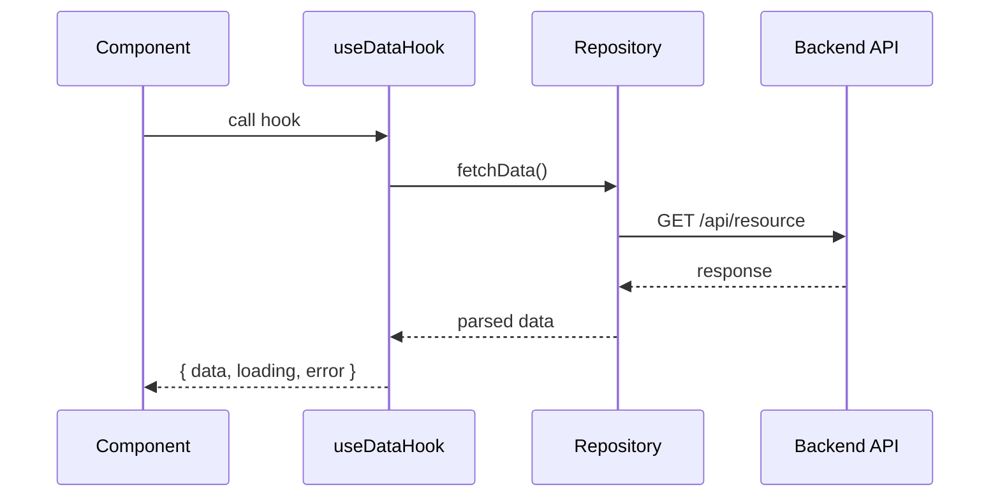
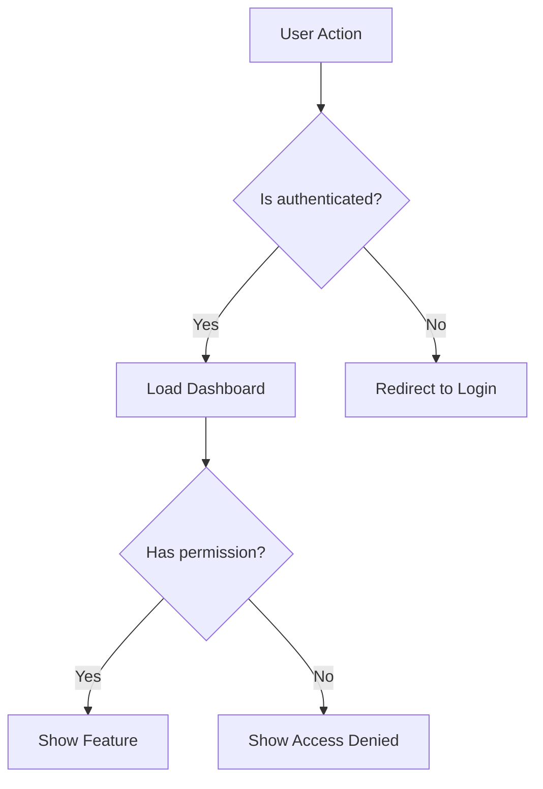
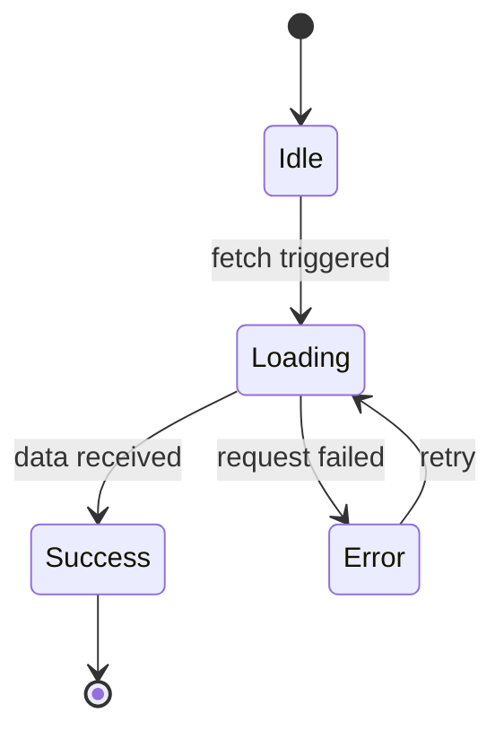

# PR Description

Analyze the changes on the current branch and produce a complete, ready-to-paste PR description. If the repo has a `pull_request_template.md`, follow its structure. Otherwise, use the default template below.

## Phase 1: Determine the Base Branch

Resolve the base branch in priority order: **develop > main > master > upstream tracking branch**.

```bash
BASE=""
for branch in develop main master; do
  if git rev-parse --verify "origin/$branch" >/dev/null 2>&1; then
    BASE="origin/$branch"
    break
  fi
done

if [ -z "$BASE" ]; then
  BASE=$(git rev-parse --abbrev-ref @{upstream} 2>/dev/null || echo "")
fi
```

If none resolve, ask the user which branch to diff against.

## Phase 2: Gather Context

Using the resolved `$BASE`, gather the full scope of changes:

```bash
git diff $BASE...HEAD
git log $BASE..HEAD --oneline --no-merges
git diff $BASE...HEAD --stat
```

Also check for a PR template:

```bash
find . -name "pull_request_template*" -path "*/.github/*" 2>/dev/null
```

If a template exists, use its structure instead of the default template below.

## Phase 3: Analyze the Changes

Read the changed files to understand:

- **What** was added, modified, or removed
- **Why** — infer from commit messages, ticket references, and code context
- **How** the pieces connect — call chains, data flow, component hierarchy
- **What features** are affected directly and indirectly

## Phase 4: Produce the PR Description

Fill out every section. Write in clear, concise prose. Use code references (backtick-wrapped file paths, function names, types) liberally.

### Default Template

```markdown
## What is the change?

<1-3 sentence summary. State whether it is a feature, fix, refactor, chore, etc. Describe what it does from a product/user perspective.>

## Why is this change being made?

<Explain the problem, business need, or motivation. Reference the Jira/Linear ticket if one exists in the branch name or commits.>

## How? (Technical description)

<Describe the technical approach. Break it down by area of change:>

- **<Area 1>**: What was done and why
- **<Area 2>**: What was done and why

<Include a Mermaid diagram here — see Diagram Rules below.>

## Features affected by this change

- **Direct**: <List the primary feature or module changed>
- **Indirect**: <List any features that consume, depend on, or are affected by the changed code>

## How can this be tested?

1. <Step-by-step QA instructions>
2. <Include preconditions, test data, expected outcomes>
3. <Include regression testing steps if the change touches shared code>

## Screenshots (optional but encouraged)

<If UI changes are present, note that screenshots should be attached. If no UI changes, write "N/A — no UI changes.">
```

---

## Diagram Rules (CRITICAL)

You MUST include at least one Mermaid diagram in the "How?" section. Choose the diagram type based on the nature of the change:

| Change Type                                                | Diagram              |
| ---------------------------------------------------------- | -------------------- |
| API calls, service interactions, hook-to-repository chains | **Sequence diagram** |
| Conditional logic, branching behavior, feature flags       | **Flowchart**        |
| State transitions (form states, loading states)            | **State diagram**    |
| Component hierarchy or module dependencies                 | **Flowchart (TD)**   |
| Data transformations through a pipeline                    | **Flowchart (LR)**   |

### Sequence Diagram Example



### Flowchart Example



### State Diagram Example



### No Custom Colors

Do NOT add custom styling, colors, or `style` directives to Mermaid diagrams. Use the default theme only. GitHub renders Mermaid with its own theme — custom colors break in light/dark mode.

### Multiple Diagrams

If the change spans multiple concerns (e.g., a new API flow AND conditional logic), include multiple diagrams — one per concern. Label each clearly.

---

## Writing Style

### Document the "Why", Not the "What"

The PR UI already shows exactly which files changed and what lines were added or removed. Do NOT restate that. Provide the **context and reasoning** the diff alone cannot convey:

- **Why** was this file changed?
- **Why** was this approach chosen over alternatives?
- **What trade-offs** were made?
- **What non-obvious side effects** should the reviewer know about?

```
BAD — restating the diff:
"Changed PrinterService.ts line 42 to add a timeout parameter to connect()."

GOOD — explaining the why:
"The printer connection had no timeout, causing the UI to hang indefinitely
when a Boca printer was powered off. A configurable timeout lets the caller
decide how long to wait based on context (box office vs. background job)."
```

### Other Style Rules

- Wrap function/type names in backticks: `usePrintService`, `PrintConfig`
- Use **bold** for emphasis on key terms
- Keep sentences concise — no filler words
- Write for a reviewer who has not seen the code
- For "How can this be tested?", write steps QA can follow without developer help

## Constraints

- Do NOT fabricate changes — only describe what is actually in the diff
- Do NOT skip sections — every section must be filled out
- Do NOT omit diagrams — at least one Mermaid diagram is mandatory
- If the diff is too large to analyze completely, focus on the most significant changes and note that minor changes were omitted for brevity
